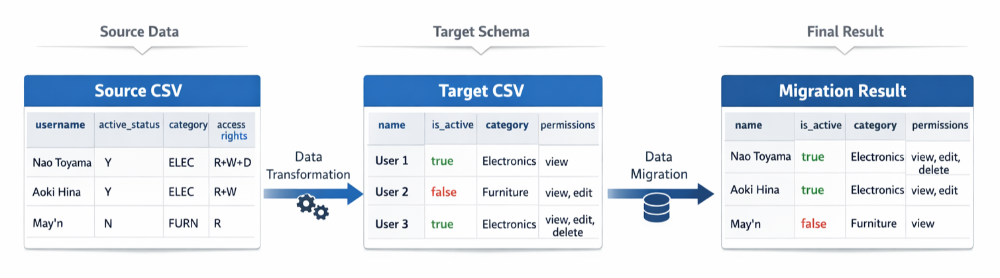
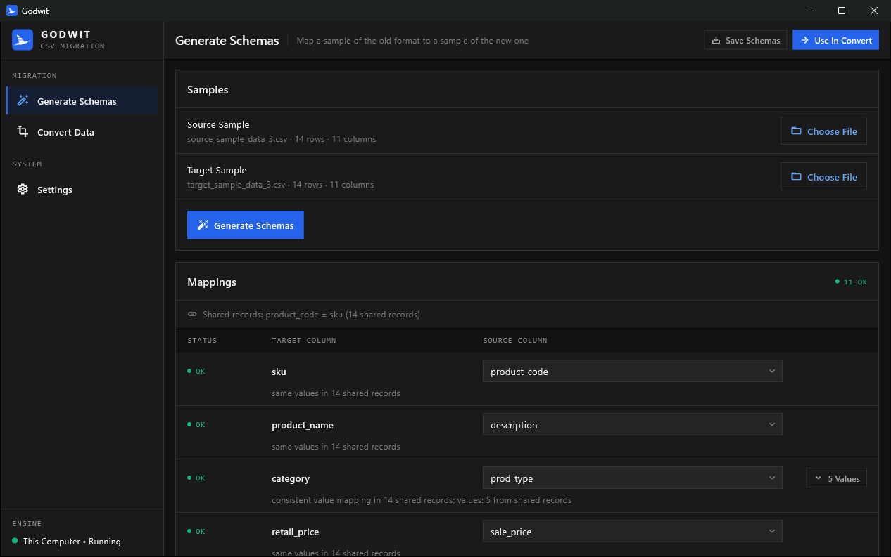
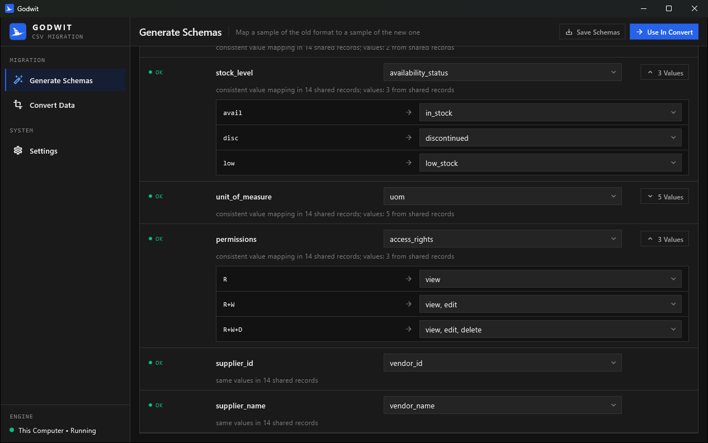
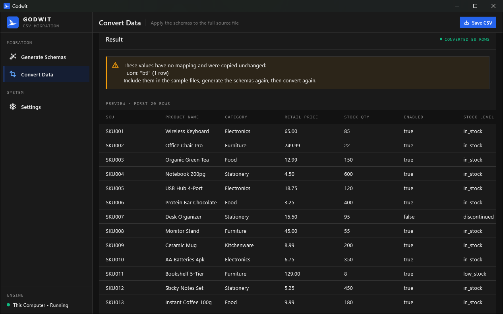
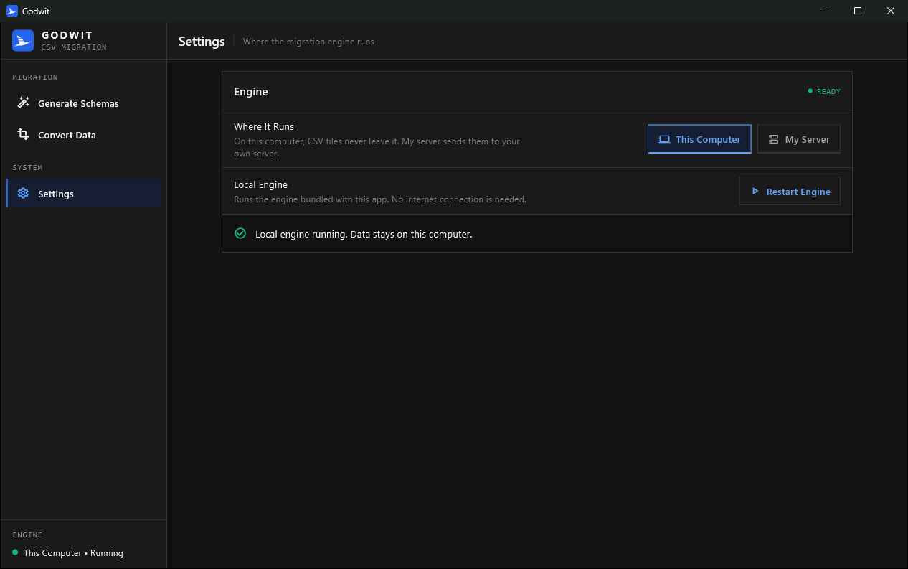

[](https://go.dev)
[](https://flutter.dev)
[](https://dart.dev)
[](#api-server-docker)
[](#building-the-windows-installer)
[](https://huggingface.co/sentence-transformers/all-MiniLM-L6-v2)
[](#how-schemas-are-generated)
[](LICENSE)

Godwit generates CSV data migration schemas and converts data with them. It analyzes a sample of the source format and a sample of the target format, maps the columns and values between them, and applies that mapping to the full data. Everything runs offline: no AI service is involved, and data never leaves the machine unless you deploy the API on your own server.

It comes as command-line tools, a desktop app (Flutter) and an HTTP API server (Docker).

The name comes from the bar-tailed godwit, a shorebird that flies non-stop from Alaska to New Zealand, the longest non-stop migration of any bird. In the logo, its wing is split into three rows like a table: data on the move.



## Screenshots

| Generate and review the mappings                          | Each value mapping, including grouped values             |
| --------------------------------------------------------- | -------------------------------------------------------- |
|  |  |

| Convert the full file                                                             | Choose where the engine runs                      |
| --------------------------------------------------------------------------------- | ------------------------------------------------- |
|  |  |

## Background: The CSV Migration Problem

Data migration projects often involve transforming CSV files from one format to another. A typical scenario involves a CSV file with hundreds or thousands of rows that needs to be converted to match a completely different structure. Column names don't match, boolean values use different representations (`Y/N` vs `true/false`), categorical codes require mapping (`ELEC` → `Electronics`), and complex grouped values present additional challenges (`R+W+D` → `view, edit, delete`).

This problem is particularly common for businesses using Point of Sale (POS) or inventory management applications. When switching from one application to another, the exported data from the current system rarely matches the import format required by the new system.

For example, a retail store migrating from an older POS system to a modern cloud-based solution might export product data where status values are coded as "A" (active), "D" (discontinued), or "L" (low stock). The new system, however, expects full text values like "in_stock", "discontinued", and "low_stock". Similarly, the old system might use category codes like "ELEC", "FURN", or "FOOD", while the new system requires complete category names like "Electronics", "Furniture", or "Food & Beverage".

The challenge multiplies when dealing with hundreds or thousands of product records, multiple enum fields requiring transformation, and complex grouped values such as permissions or access rights. Manual conversion becomes impractical, error-prone, and time-consuming.

The traditional approach requires manually comparing both CSVs, creating a mapping document, writing transformation code, testing, debugging, and repeating the process. For a 50-column CSV with dozens of enum mappings, this process can take hours or even days.

This project was created to address these challenges through a structured, automated approach, specifically targeting scenarios where businesses need to migrate data between different software systems.

## Migration Schemas

The tool uses a structured JSON schema format that explicitly defines how to map data between formats. This establishes a clear contract for data transformation. Schemas can be written by hand or generated from samples (see [How Schemas Are Generated](#how-schemas-are-generated)), and the converter applies them to any amount of data.

### Target Schema

Example Target CSV:
| name | is_active | category | permissions |
|--------|-----------|--------------|--------------------|
| User 1 | true | Electronics | view |
| User 2 | false | Furniture | view, edit |
| User 3 | true | Electronics | view, edit, delete |

Defines the destination structure:

```json
[
  {
    "column": "name",
    "values": []
  },
  {
    "column": "is_active",
    "values": ["true", "false"]
  },
  {
    "column": "category",
    "values": ["Electronics", "Furniture"]
  },
  {
    "column": "permissions",
    "values": ["view", "view, edit", "view, edit, delete"]
  }
]
```

- `column` - The CSV column name (from CSV headers)
- `values` - Array of all possible categorical values for this column. Populated only if:
  - The column contains a limited, fixed set of values (enum, category, status, boolean)
  - The column has no relational dependency on other columns (not a foreign key or related name field)
  - Set to empty array `[]` if the column contains dynamic values (IDs, names, numbers, dates, free text)

### Source Schema

Example Source CSV:
| username | active_status | category | access_rights |
|------------|---------------|----------|---------------|
| Nao Toyama | Y | ELEC | R+W+D |
| Aoki Hina | Y | ELEC | R+W |
| May'n | N | FURN | R |

Maps source to target with transformations:

```json
[
  {
    "column": "username",
    "target_column": "name",
    "values": []
  },
  {
    "column": "active_status",
    "target_column": "is_active",
    "values": ["Y", "N"],
    "values_mapping": {
      "Y": "true",
      "N": "false"
    }
  },
  {
    "column": "category",
    "target_column": "category",
    "values": ["ELEC", "FURN"],
    "values_mapping": {
      "ELEC": "Electronics",
      "FURN": "Furniture"
    }
  },
  {
    "column": "access_rights",
    "target_column": "permissions",
    "values": ["R", "R+W", "R+W+D"],
    "values_mapping": {
      "R": "view",
      "R+W": "view, edit",
      "R+W+D": "view, edit, delete"
    }
  }
]
```

- `column` - The source CSV column name (header)
- `target_column` - The target schema column name that `column` maps to
- `values` - Array of all possible categorical values for this column. Populated only if:
  - The column contains a limited, fixed set of values (enum, category, status, boolean)
  - The column has no relational dependency on other columns (not a foreign key or related name field)
  - Set to empty array `[]` if the column contains dynamic values (IDs, names, numbers, dates, free text)
- `values_mapping` - Object that maps source CSV values to target schema values. Populated only when:
  - BOTH source `values` AND target `values` are non-empty (both are categorical)
  - Maps each source categorical value to its corresponding target categorical value
  - Set to `null` if either source or target `values` is empty (one or both are dynamic)

Generated schemas may also include:

- `token_mapping` and `token_separator` - Per-part mapping for grouped values (`R` → `view`, `W` → `edit`, `D` → `delete`), so combinations not in the sample, such as `R+D`, still convert
- `unresolved` - Source values with no mapping, for manual review
- `evidence` - How the mapping was found

### Migration Result

| name       | is_active | category    | permissions        |
| ---------- | --------- | ----------- | ------------------ |
| Nao Toyama | true      | Electronics | view, edit, delete |
| Aoki Hina  | true      | Electronics | view, edit         |
| May'n      | false     | Furniture   | view               |

The converter reads these schemas and performs the actual data transformation, independently of how the schemas were created.

Writing schemas by hand gives complete control, but it is slow and error-prone for large CSVs. A 38-column product catalog, for example, takes hours to map: identifying all enum values, checking each column for relationships and typing out the JSON. Generating the schemas from samples automates that work.

## How Schemas Are Generated

Generating a schema means classifying columns, listing their values, matching columns and mapping values. Each part is handled by the lightest method that does it reliably, in four steps. Nothing leaves the machine, and the only model involved is a 43 MB embedding model bundled in the repository.

**Step 1: Column profiling.** For each column the tool works out its data type (integer, decimal, date, email, URL, boolean or text), whether it holds fixed values or dynamic data, and the exact list of distinct values. It also applies the `X_id + X_name` relationship rule: a key column and a same-prefix column whose values correspond one-to-one (such as `store_id` and `store_name`) describe a related entity, not a fixed category.

**Step 2: Learning from shared records.** When the source and target samples contain some of the same records, as the samples in this repository do, the tool finds a shared key such as `product_id = id` and lines up the rows. It then reads the mappings directly from the data: if every row with `ELEC` has `Electronics` on the other side, the mapping is proven rather than guessed. Grouped values are learned per part. The samples only need to share some records. To avoid lining up unrelated rows that happen to use the same ids, another column must agree as well.

**Step 3: String rules.** Anything not settled by shared records is matched by rules:

- Column names are compared word by word, with common abbreviations spelled out (`qty`, `uom`, `desc`).
- Values are compared by exact match, yes/no words (`Y`/`1` → `true`), prefixes (`ELEC` → `Electronics`), initials (`F&B` → `Food & Beverage`) and abbreviations (`btl` → `bottle`).

A rule that matches more than one candidate abstains instead of guessing.

**Step 4: Embedding model.** A small sentence-embedding model ([all-MiniLM-L6-v2](models/all-MiniLM-L6-v2/README.md)) compares meaning. It mostly helps with column names that share no words, such as `vendor_company` → `supplier_name`. It runs in pure Go, with no CGo, no native libraries and no network access. An embedding model only turns text into numbers, so text inside the CSV cannot instruct it to do anything. A value match from this step is accepted only when it is clearly ahead of the runner-up.

Every mapping records the evidence it came from:

- **`CHECK`** marks mappings that rely on the embedding model, or on elimination (the only value left).
- **`UNRESOLVED`** lists source values with no mapping.
- **Converter warnings** list any value the converter had to copy unchanged.

### Results

Tested on the four sample pairs in this repository, and on two extra pairs from other domains (customers and orders) that were not used while writing the rules:

| Test                                                          | Columns         | Values                   |
| ------------------------------------------------------------- | --------------- | ------------------------ |
| Repository samples, using shared records                      | 44/44           | 51/51                    |
| Repository samples, as if no records were shared, steps 1+3   | 41/44 (1 wrong) | 46/51 (0 wrong)          |
| Repository samples, as if no records were shared, steps 1+3+4 | 44/44           | 51/51                    |
| Other domains, shared records                                 | 22/22           | 35/35                    |
| Other domains, different records                              | 22/22           | 35/35 (3 marked `CHECK`) |

These test sets are small and clean, and the abbreviation lists include abbreviations that appear in the repository samples, so expect lower accuracy on real exports. Always review the output.

### Strengths and Limits

Data never leaves the machine. It runs on ordinary hardware in about a second, with no GPU, service or API key. Results are deterministic, and every mapping explains how it was found. Mappings learned from shared records are proven by the data instead of guessed.

Accuracy depends on the samples. Without shared records, matching relies on names and values, so a value whose meaning is not visible in its spelling (`POS` → `in_store`) can only be resolved by elimination or left for manual review. The bundled embedding model is English-only; for other languages only steps 1 to 3 help.

## Limitations

### Sample Data Quality

Generated schemas can only map values that appear in the samples. If a CSV contains 50 possible status values but the sample only shows 3, only those 3 are mapped. The converter warns about any value it copies unchanged.

Solution: Ensure sample data represents all possible values for enum columns, including edge cases and rare combinations, and include some of the same records in both samples.

### Complex Business Rules

The tool maps columns and values; it does not apply business logic. If "status=pending + age>30 days" should map to "overdue", this logic must be handled manually or in post-processing.

Solution: Use the generated schemas for structural mapping, then add business logic separately in custom transformation code.

### Edge Cases

Matching can miss subtle patterns or make incorrect assumptions about relationships between columns, particularly with ambiguous or unusual data patterns and without shared records.

Solution: Always review generated schemas, especially lines marked `CHECK` or `UNRESOLVED`, and test with a subset of real data before production use.

## Getting Started

Prerequisites:

- Go 1.23 or higher, for the command-line tools and the API server
- Flutter with desktop support and [Inno Setup 6](https://jrsoftware.org/isinfo.php), only to build the desktop app
- Docker, only to deploy the API server

Clone the repository:

```bash
git clone https://github.com/elrizwiraswara/godwit.git
cd godwit
```

Run the tests with `go test ./...`.

## Usage

### Generate Migration Schemas

```bash
go run generator/generate_schemas.go
```

**You will be asked for these parameters:**

- Path to source sample CSV (migration source sample)
- Path to target sample CSV (migration destination sample)
- Name for the schema (Suffix for output file name)

**Example:**

```bash
go run generator/generate_schemas.go
Please enter the source sample CSV path: input/samples/source_sample_data_3.csv
Please enter the target sample CSV path: input/samples/target_sample_data_3.csv
Please enter a name for the schemas: 3
```

Run it from the repository root so the embedding model in `models/` is found.

### Output

The tool generates two JSON schema files in the `output/schemas/` directory:

1. **target_schema_3.json** - Target data structure schema
2. **source_schema_3.json** - Source to target mapping schema

It also prints a review table showing each mapping and its evidence. Review lines marked `CHECK` or `UNRESOLVED` before converting.

### CSV Migration

```bash
go run converter/convert_csv.go
```

**You will be asked for these parameters:**

- Path to source data CSV (migration source data)
- Path to source schema JSON (migration source data schema)
- Path to target schema JSON (migration destination data schema)
- Name for the schema (Suffix for output file name)

**Example:**

```bash
go run converter\convert_csv.go
Please enter the source data CSV path: input\source_data_3.csv
Please enter the source schema JSON path: output\schemas\source_schema_3.json
Please enter the target schema JSON path: output\schemas\target_schema_3.json
Please enter a name for the output file: 3
```

### Output

The tool generate the converted CSV file in the `output/` directory. If a column has value mappings but a value is not among them (for example a status that did not appear in the sample), the value is copied unchanged and listed in a warning so it can be fixed.

## Desktop App

The Flutter desktop app in `app/` puts the generator and converter behind a user interface, with a review step before converting:

- Each target column shows its status: OK, Check, Unresolved or No source.
- The source column can be changed from a dropdown, and the engine then re-maps that column's values.
- Value mappings can be edited.
- The converted CSV can be previewed and saved.

In Settings, the app can use the engine in two ways:

- **On this computer (default):** the app starts the bundled engine itself and stops it when the app closes. The engine listens only on 127.0.0.1 and requires a random key created for each session, so other programs cannot use it. CSV data never leaves the computer.
- **My server:** the app connects over HTTPS, with an API key, to the API server running on your own server (see below). The key is kept in memory only.

### Building the Windows Installer

```powershell
powershell -ExecutionPolicy Bypass -File scripts\build_windows.ps1 -Version 1.0.0
```

This requires Go, Flutter with Windows desktop support, and Inno Setup 6. It produces `dist\Godwit-Setup-1.0.0.exe` (about 51 MB), which installs the app, the engine and the embedding model for the current user, without administrator rights. The installer is not code-signed, so Windows SmartScreen will show a warning until it is.

For development, build the engine once with `scripts\build_windows.ps1 -SkipInstaller`, then run `flutter run -d windows` in `app/`. Tests:

- `flutter test` runs the unit tests, and also the engine tests once the engine is built.
- `flutter test integration_test -d windows` drives the UI with the real engine.

macOS and Linux builds are not tested yet. The code is cross-platform, but running the bundled engine inside a sandboxed macOS app needs extra signing setup.

## API Server (Docker)

The same engine runs as an HTTP API that other applications can call:

```bash
GODWIT_API_KEYS=key-for-app-1,key-for-app-2 docker compose up -d --build
```

Every `docker compose` command needs `GODWIT_API_KEYS`, so on a server it is easier to put it in a `.env` file next to `docker-compose.yml` (`GODWIT_API_KEYS=key-for-app-1,key-for-app-2`) and run plain `docker compose up -d --build`.

The image is about 53 MB. It contains only the server binary and the model, and it runs as a non-root user on a read-only filesystem. The compose file publishes it on `127.0.0.1:8080` of the host, so put a reverse proxy with HTTPS (Caddy, Nginx, Traefik) in front of it. The server refuses to start without API keys unless it listens only on localhost.

All endpoints except `/healthz` need the header `Authorization: Bearer <key>`:

| Method | Path          | Request (JSON)                                                                                        | Response (JSON)                                                                           |
| ------ | ------------- | ----------------------------------------------------------------------------------------------------- | ----------------------------------------------------------------------------------------- |
| GET    | `/healthz`    | none                                                                                                  | `status`, `embedding_model`                                                               |
| GET    | `/v1/status`  | none (checks the API key)                                                                             | `status`, `embedding_model`                                                               |
| POST   | `/v1/schemas` | `source_sample_csv`, `target_sample_csv`, optional `overrides` (`{"target_column": "source_column"}`) | `target_schema`, `source_schema`, `source_columns`, `shared_key`, `unused_source_columns` |
| POST   | `/v1/convert` | `source_csv`, `source_schema`, `target_schema`                                                        | `csv`, `rows`, `unmapped` (values copied unchanged)                                       |

CSV fields hold the file contents as text. For example:

```bash
curl -H "Authorization: Bearer key-for-app-1" -H "Content-Type: application/json" \
  -d '{"source_sample_csv": "id,active\n1,Y\n2,N\n", "target_sample_csv": "id,is_active\n1,true\n2,false\n"}' \
  https://csv.example.com/v1/schemas
```

Configuration (environment variables):

- `GODWIT_API_KEYS` - Comma-separated API keys, so each application can have its own
- `GODWIT_ADDR` - Listen address (default `127.0.0.1:8080`; the image uses `0.0.0.0:8080`)
- `GODWIT_CORS_ORIGINS` - Comma-separated browser origins allowed to call the API, for web apps
- `GODWIT_MAX_BODY_MB` - Request size limit (default 32)
- `GODWIT_MODEL_DIR` - Embedding model directory (default: next to the binary)

CSV data is processed in memory and never stored or logged; logs contain only the method, path, status and duration of each request. Schema generation accepts samples of up to 5,000 rows and 500 columns. To run the server without Docker, use `go run ./server`.

## CSV Sample Data

The repository includes four pairs of sample CSV files for testing, for example:

- `input/samples/source_sample_data_3.csv` - Source format example (14 rows)
- `input/samples/target_sample_data_3.csv` - Target format example (14 rows)
- `input/source_data_3.csv` - Larger source dataset (50 rows)

## Project Structure

```
godwit/
├── generator/
│   └── generate_schemas.go    # Schema generation command
├── converter/
│   └── convert_csv.go         # CSV conversion command
├── server/                    # API server command
├── api/                       # HTTP API handlers
├── infer/                     # Schema generation (steps 1-4)
├── convert/                   # Applies schemas to CSV data
├── embedding/                 # Pure-Go runner for the embedding model
├── models/
│   └── all-MiniLM-L6-v2/      # Bundled embedding model (43 MB)
├── app/                       # Flutter desktop app
├── config/
│   └── config.go              # Embedding model location
├── types/
│   └── schema.go              # Schema type definitions
├── utils/
│   └── utils.go               # Utility functions (CSV/JSON handling)
├── tools/
│   ├── convert_model/         # Converts model weights to float16
│   └── brand/                 # Renders the logo into the app's icon files
├── assets/brand/              # Logo, app icon and README header (SVG)
├── docs/screenshots/          # Screenshots for this README
├── scripts/
│   └── build_windows.ps1      # Builds the Windows app and installer
├── installer/windows/         # Inno Setup installer script
├── Dockerfile                 # API server image
├── docker-compose.yml         # API server deployment
├── input/
│   └── samples/               # Sample CSV files
├── output/
│   └── schemas/               # Generated schema files
└── README.md
```

## Troubleshooting

**"Embedding model not loaded"**<br/>
Run the generator from the repository root, and check that `models/all-MiniLM-L6-v2/` contains `model.safetensors`, `vocab.txt` and `config.json`. Without the model, generation still runs steps 1 to 3.

**Schema doesn't match expectations**<br/>
Read the evidence shown for each mapping in the review table or the desktop app. Consider adjusting the sample CSV data to be more representative: include every value of each fixed-value column, and some of the same records in both samples. In the desktop app, a wrong source column can be changed from its dropdown.

## Contributing

Contributions are welcome. Please submit issues or pull requests through the GitHub repository.

## License

MIT License - see [LICENSE](LICENSE) file for details

## Author

Created by elrizwiraswara (https://github.com/elrizwiraswara) with some help from [Claude.ai](https://claude.ai/)
